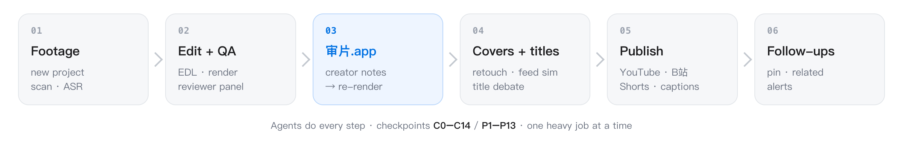
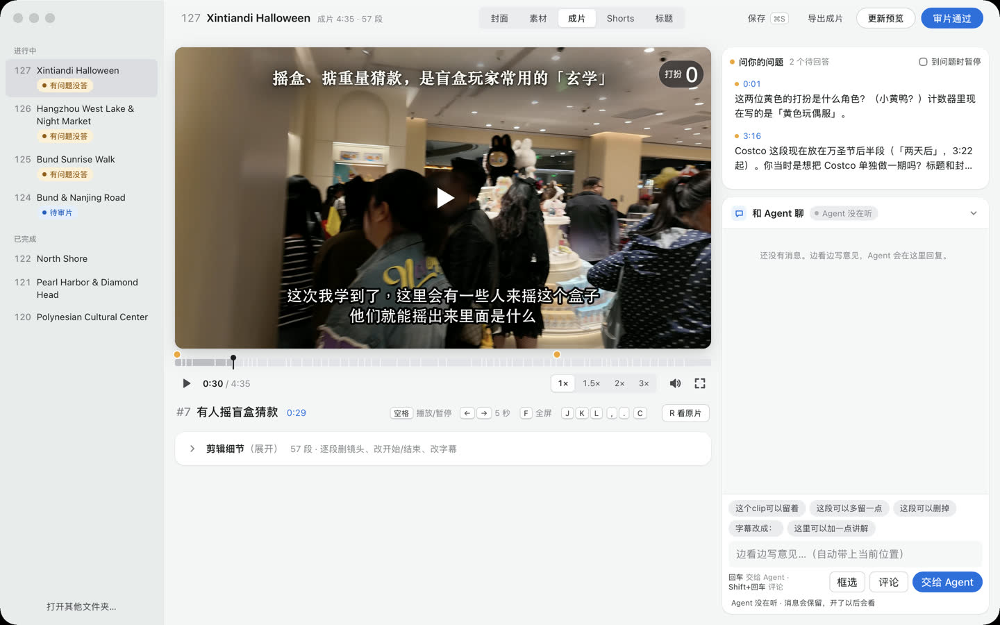
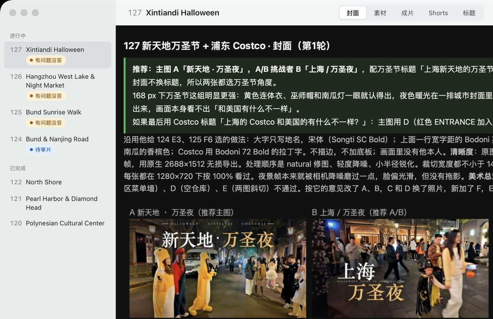
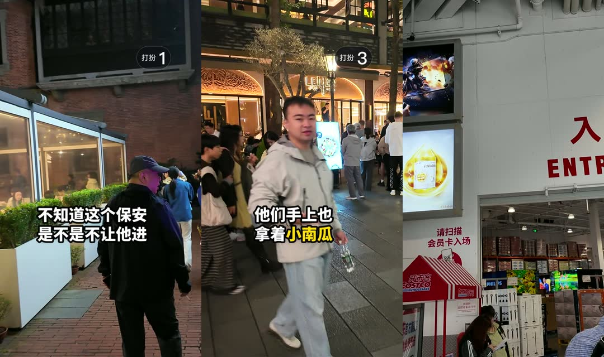

# YouTube Manager

The toolchain behind the travel-vlog channel 「Yizhou的一周」 (YouTube + Bilibili). Agents (Claude Code) do the
editing, packaging and publishing; the creator reviews in 「审片.app」 and approves.
No editing software, no web dashboard: the procedure lives in [skills](.claude/skills/), and this code is what they call.

<picture>
  <source media="(prefers-color-scheme: dark)" srcset="assets/readme/pipeline-dark.png">
  
</picture>

## 审片.app

The creator watches the cut and the raw footage, answers the agent's timestamped questions, and leaves notes in the
chat; the agent applies them and re-renders. Details: [`app/README.md`](app/README.md).



| 封面 tab: cover options, pick with 「选这个」 | What the renderer makes: 片头字 note + captions |
|---|---|
|  |  |

Two vertical Shorts per episode, cut as open loops back to the long video (`scripts/make_short.py`):



## Quick start

macOS, Apple Silicon. Projects live at `~/Desktop/<NNN> - <Place>/`.

```bash
python3 -m venv venv && ./venv/bin/pip install -r requirements.txt
uv venv -p 3.12 asrvenv && uv pip install -p asrvenv/bin/python mlx-qwen3-asr opencc-python-reimplemented
brew install ffmpeg whisper-cpp
app/build.sh --install                       # 审片.app
```

- `models/`: whisper.cpp ggml models + Silero VAD. `.tools/` (optional): `mlx-audio`, `rife`.
- Credentials (gitignored): `config/client_secrets.json`, `config/token.pickle` (written on first auth),
  `~/.config/biliup/cookies.json` (`biliup -u ~/.config/biliup/cookies.json login`).
- Then tell Claude Code "edit this trip" or "publish NNN".

## Episode lifecycle

| Step | Where |
|---|---|
| Footage → project | `scripts/new_project.sh`; one director agent per episode for multi-episode trips |
| Watch | `src.editor.scan`, `src.editor.transcribe` (Qwen3-ASR), `captions_clean` |
| Edit + QA | `edl.json` → `src.editor.render`; reviewer sub-agents, `xcheck`, audience panel |
| 审片 | 审片.app (素材 / 成片 / Shorts tabs, chat, questions) |
| Covers + titles | `src/thumbnail_generator/`, `scripts/feed_sim.py`, `title_check`; picked in the 封面 / 标题 tabs |
| Publish | YouTube + captions + localization, Bilibili + 合集, Shorts (P1–P13) |
| Follow-ups | `episode_audit.py`, `post_publish_followups.py`, `cleanup_previews.py` |

The how-to lives in [edit-video-chat](.claude/skills/edit-video-chat/SKILL.md),
[publish-video-chat](.claude/skills/publish-video-chat/SKILL.md) and [grow-channel](.claude/skills/grow-channel/SKILL.md).

## Key commands

Run from the repo root with `./venv/bin/python`.

| Command | Does |
|---|---|
| `-m src.editor.checkpoint "<project>"` | Status + next step (C0–C14); `done C<n> "note"` |
| `-m src.editor.render "<project>" --preview\|--final` | 1080p preview / 4K master |
| `-m src.editor.lint "<project>"` | Pre-render EDL checks |
| `-m src.editor.chat "<project>" watch\|reply "…"` | Listen to / answer the review chat |
| `scripts/make_short.py <spec.json>` | Vertical Short |
| `scripts/episode_audit.py <ep>\|--all` | Publish audit after every upload chain |
| `scripts/post_publish_followups.py --due` | Pinned comment, Shorts Related video |
| `scripts/upload_dashboard.py <eps> --loop` | Live upload page in `sessions/` |
| `scripts/status.py` | One-screen board of running jobs |
| `scripts/review_open.sh <ep>` | Review pages in a browser (fallback to the app) |

## Layout

```
.claude/skills/   edit-video-chat (SKILL, LESSONS, audience panel) · publish-video-chat · grow-channel
app/              审片.app (Swift shell; backend in src/editor/app_server.py)
src/editor/       EDL, ASR, render, overlays, review pages, chat, questions, checkpoints, QA tools
src/thumbnail_generator/  retouch, editorial / layered covers, export
src/uploader/ src/auth/ src/youtube_client/ src/analytics/   YouTube API
scripts/          Shorts, publish, Bilibili, growth, dashboards, cards, tests
templates/        project skeleton, director briefs
assets/           fonts, SFX, README images
```

## Conventions

- **One heavy job at a time:** renders, Demucs, whisper go through `scripts/render_lock.sh <cmd>`; ASR through `src.editor.asrlock`.
- **Checkpoints:** C0–C14 (edit) and P1–P13 (publish) so any agent resumes without redoing or re-uploading.
- **EDL is the source of truth;** raw footage is read-only.
- **Never commit `sessions/` or `docs/`;** credentials stay in `config/` and `~/.config/`.
- **Approvals:** the app's picks append to `sessions/APPROVALS.md`; agents act only on that log or the creator's words.

## Tests

```bash
for t in scripts/test_*.py; do ./venv/bin/python "$t" || echo "FAIL $t"; done
```

## Agents

Read [`AGENT_WORKFLOW.md`](AGENT_WORKFLOW.md), [`CLAUDE.md`](CLAUDE.md), then the skill and its
[`LESSONS.md`](.claude/skills/edit-video-chat/LESSONS.md). Every creator correction becomes a lesson; every episode
tries one new technique. License: MIT.
